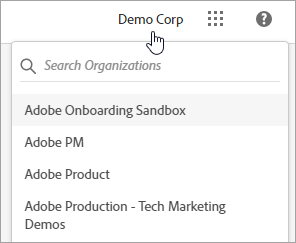
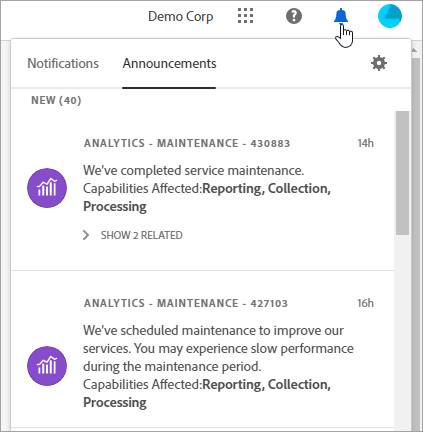
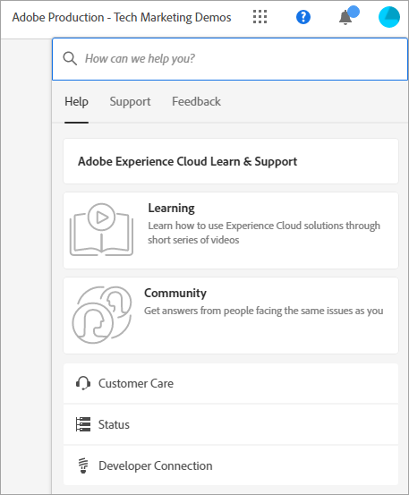

# Introdução ao uso do CX Enterprise {#get-started}

Entre no [Adobe CX Enterprise](https://experience.adobe.com) para iniciar seus aplicativos e, em seguida, use o cabeçalho unificado para gerenciar seu perfil, verificar notificações e encontrar ajuda, tudo em um só lugar.

## Antes de começar {#before-you-begin}

Você precisa de uma Adobe ID que tenha sido provisionada para os produtos CX Enterprise de sua organização. Se você não consegue entrar ou não consegue ver os aplicativos esperados, contate o [[!UICONTROL administrador]](administration/admin-console.md) do [ do CX Enterprise].

## Fazer logon no CX Enterprise {#sign-in}

Faça logon e verifique se você está na [organização](administration/organizations.md) correta.

1. Navegue até [Adobe CX Enterprise](https://experience.adobe.com).
1. Digite seu endereço de email do Adobe e clique em **[!UICONTROL Continuar]**.
1. Clique em uma conta.
1. Insira sua senha.
1. Verifique se você está na organização correta.

   

   **Verificar sua organização**

   A [organização](administration/organizations.md) é exibida no cabeçalho da interface.

   Se sua organização usa Federated IDs, a CX Enterprise permite fazer logon com o logon único de sua organização sem precisar inserir seu endereço de email e senha. Adicione `#/sso:@domain` à URL do CX Enterprise (`https://experience.adobe.com`) para realizar esta tarefa.

   Por exemplo, para uma organização com Federated IDs e o domínio `example.com`, defina o link do URL para `https://experience.adobe.com/#/sso:@example.com`. Você também pode ir diretamente para um aplicativo específico marcando esse URL, anexado com o caminho do aplicativo. (Por exemplo, para Adobe Analytics, `https://experience.adobe.com/#/sso:@example.com/analytics`.)

   **Observação:** o administrador de sua organização pode restringir o acesso aos produtos da Adobe por endereços IP. Em caso positivo, você poderá receber um erro depois de fazer logon no CX Enterprise ou alternar para uma organização com isso ativado. Mais informações disponíveis em [Limitar o acesso ao produto por endereços IP](https://helpx.adobe.com/enterprise/using/ip-based-access.html).

## Acessar aplicativos do CX Enterprise {#applications}

Depois de fazer logon no CX Enterprise, você pode acessar rapidamente todos os aplicativos, serviços e organizações pelo cabeçalho unificado.

Para acessar os aplicativos e serviços do CX Enterprise fornecidos para você em sua organização, acesse o seletor de aplicativos .

## Gerenciar seu perfil de usuário {#profile}

No menu [!UICONTROL Perfil], você pode:

* Especificar um tema escuro (nem todos os aplicativos são compatíveis com esse tema)
* Gerenciar [Preferências](features/account-preferences.md) do CX Enterprise
* Selecione ou pesquise por uma [Organização](administration/organizations.md)
* Exibir [!UICONTROL Avisos legais]
* Fazer logoff
* Configurar as preferências, notificações e assinaturas da conta

## Exibir notificações e avisos no produto {#notifications}

Clique no ícone de sino para exibir notificações e avisos. Os avisos podem ser atualizações relevantes e acionáveis, incluindo lançamentos de produtos, avisos de manutenção, itens compartilhados e solicitações de aprovação.

Para gerenciar notificações e alertas, consulte [Preferências e notificações da conta](features/account-preferences.md).

## Obter ajuda e suporte {#help}

Acesse o aprendizado e a ajuda usando a **[!UICONTROL Central de ajuda]** () no cabeçalho, incluindo o conteúdo da ajuda (documentação, tutoriais e cursos) no [Experience League](https://experienceleague.adobe.com/?lang=pt-BR#home), bem como recursos adicionais para aplicativos individuais. Você também pode enviar feedback aberto e criar tíquetes de suporte priorizados.

O menu [!UICONTROL Ajuda] também fornece acesso a:

* **[!UICONTROL Suporte]:** crie um tíquete de suporte ou contate o [!UICONTROL Suporte] usando o Twitter.
* **[!UICONTROL Feedback]:** Compartilhe um feedback sobre a sua experiência com o CX Enterprise. Seu feedback é usado para melhorar os produtos e serviços do Adobe.
* **[!UICONTROL Status]:** navegue até `https://status.adobe.com/experience_cloud` e verifique o status operacional do produto e [!UICONTROL Gerenciar assinaturas].
* **[!UICONTROL Developer Connection]:** Navegue até `adobe.io` e encontre a documentação do desenvolvedor.

## Mais ajuda sobre este tópico {#more-help}

* [Gerenciamento de usuários e produtos na Admin Console](administration/admin-console.md)
* [Introdução ao serviço Pessoas](services/getting-started.md)
* [Preferências e notificações da conta](features/account-preferences.md)
